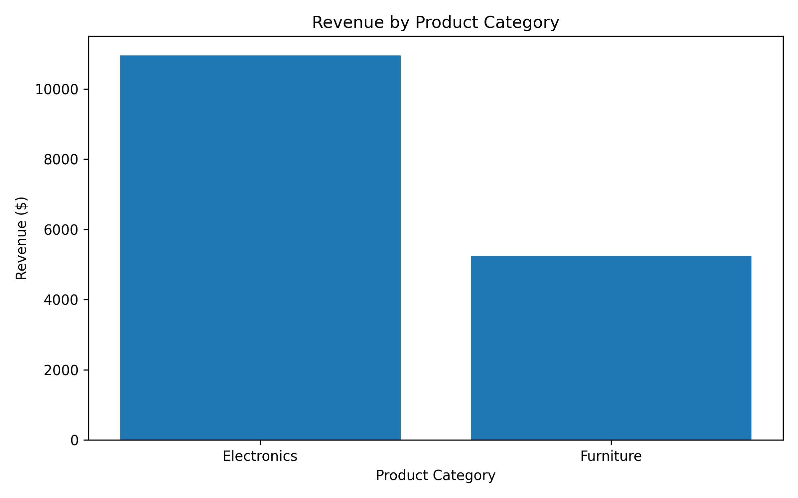
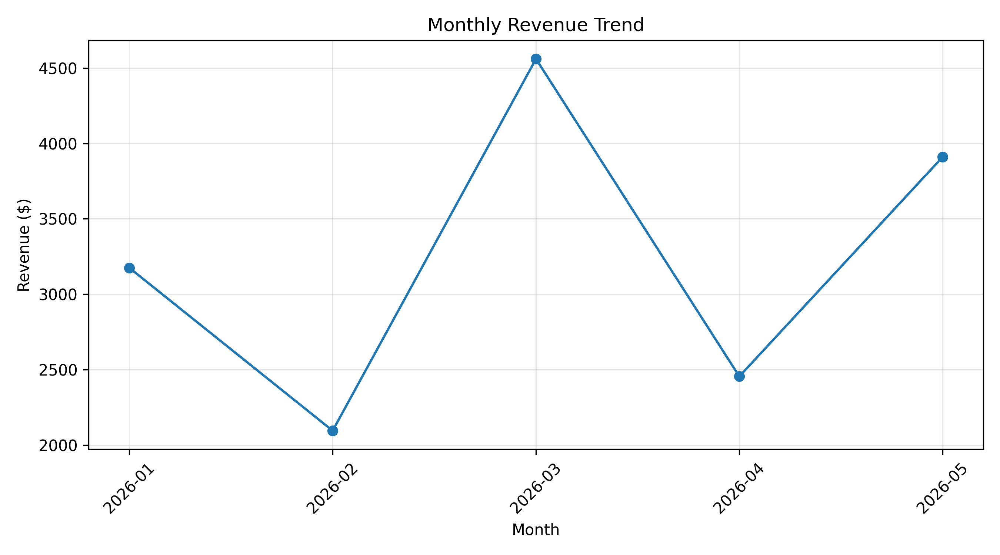

# Retail Sales & Inventory Analysis

## Project Overview

This project analyzes simulated retail sales data using Python, SQL, SQLite, pandas, and Matplotlib. The goal is to evaluate revenue, profit, product performance, and recorded inventory levels and communicate findings through visualizations.

## Business Questions

- Which product categories generate the most revenue and profit?
- Which products sell the most units?
- How does revenue change month to month?
- Which regions generate the most revenue?
- Which products have low recorded inventory?

## Tools & Technologies

- Python
- pandas
- SQL
- SQLite
- Matplotlib
- CSV data

## Key Results

Based on 20 simulated retail orders:

- **Total revenue:** $16,195
- **Total profit:** $6,673
- **Units sold:** 113
- **Electronics revenue:** $10,955
- **Furniture revenue:** $5,240
- **Profit margin:** approximately 41.2%

Electronics accounts for approximately 67.6% of total revenue in this sample. This is a descriptive finding from simulated data and should not be treated as a forecast of actual retail performance.

## Monthly Revenue Findings

- March generated the highest monthly revenue at $4,560.
- February generated the lowest monthly revenue at $2,095.
- Revenue increased approximately **117.7%** from February to March.
- May revenue reached $3,910, below the March peak.

These findings describe the simulated dataset and do not establish a recurring seasonal pattern.

## Regional Revenue Findings

- The East region generated the highest revenue at $5,275 (32.6% of total revenue).
- The North region ranked second at $4,580.
- The South region generated $3,630.
- The West region generated the lowest revenue at $2,710 (16.7% of total revenue).

The difference between the East and West suggests an opportunity to investigate regional sales performance. The simulated data does not establish why the regions differ.

## Inventory Findings

Using the latest recorded stock level for each product, the analysis identified:

- Office Chair: 3 units remaining.
- Laptop: 6 units remaining.

These are sample inventory values, not live stock levels.

## Visualizations

### Revenue by Product Category



### Monthly Revenue Trend



## Project Structure

```text
retail-sales-analysis/
├── data/
│   ├── sales.csv
│   ├── retail_sales.db
│   ├── revenue_by_category.png
│   └── monthly_revenue_trend.png
├── analyze_sales.py
├── load_data.py
├── sales_analysis.sql
├── run_sql.py
└── README.md
```

## Limitations

The dataset is simulated and contains only 20 orders. Inventory values are recorded sample values, not live stock levels. The findings demonstrate analytical techniques rather than actual business outcomes.

## Future Improvements

- Expand the dataset with more orders and a longer time period.
- Add inventory alerts for products below a defined stock threshold.
- Improve chart formatting and labeling.
- Add automated data-quality checks.
- Explore additional product and regional performance metrics.